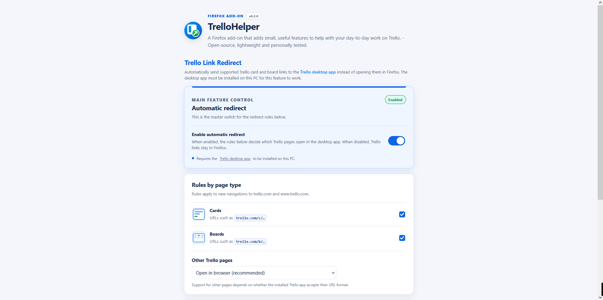

# TrelloHelper

**Version:** 0.2.0  
**Platform:** Mozilla Firefox (Add-on Manifest V2)  
**Developed and designed by:** [RedstoneFuture](https://github.com/RedstoneFuture) ([rauh-solutions.de](https://rauh-solutions.de)), [game_crash](https://github.com/gamecrash534)

**» Firefox Add-on Page:** https://addons.mozilla.org/de/firefox/addon/trellohelper

TrelloHelper is an independent Firefox add-on that adds small, useful features to help with your day-to-day work with the task management software "Trello" by Atlassian. This add-on is open-source, lightweight, and personally tested. The project is designed in such a way that it can be expanded with new features over time.

## Features

### Trello Link Redirect

If you have installed the [Trello desktop app](https://trello.com/platforms) on your computer, Trello links beginning with `https://` do not open in the desktop app by default. This add-on feature resolves this issue by redirecting Trello links to `trello://`, which are usually detected by the desktop app.

> [!NOTE]  
> Firefox usually asks for permission the first time an external Trello link is opened.

> [!WARNING]  
> The feature is intended for systems where the [Trello desktop app](https://trello.com/platforms) is installed. Without the desktop app, external links may not open as expected!

#### How it works

Trello Link Redirect intercepts top-level HTTPS navigations to `trello.com` and `www.trello.com`. It classifies each URL as a card link (`/c/…`), board link (`/b/…`), or another Trello page, then applies the user's configured rule. The extension preserves the original path, query string, and fragment by replacing only the `https://` scheme with `trello://`.

## Settings

The add-on provides a settings page so that it can be configured as required and features can be enabled or disabled.

Click the TrelloHelper toolbar button to enable or disable automatic redirection. The `ON` or `OFF` badge indicates the current state. Right-click the toolbar button and choose **Open TrelloHelper settings…** to configure the add-on feature.

The settings page lets you:

- Trello Link Redirect: Enable or disable automatic redirection.
- Trello Link Redirect: Choose whether card links should open in the desktop app.
- Trello Link Redirect: Choose whether board links should open in the desktop app.
- Trello Link Redirect: Choose whether other Trello pages should open in the desktop app or remain in Firefox.
- Trello Link Redirect: Close the original Firefox tab after Firefox loses focus, with a short safeguard delay.

Preferences are saved locally using `browser.storage.local`. The extension does not send preferences or browsing data to an external server.

## Temporary installation for testing

1. Extract the ZIP archive to a folder.
2. Open Firefox and navigate to `about:debugging#/runtime/this-firefox`.
3. Click **Load Temporary Add-on…** and select the project's `manifest.json` file.
4. Click the TrelloHelper toolbar button to toggle automatic redirection.
5. Right-click the toolbar button and select **Open TrelloHelper settings…** to open the settings page.

Temporary add-ons are removed when Firefox closes. For normal installation in a standard release build of Firefox, the packaged extension must be signed by Mozilla.

## Notes and limitations

- This project uses Manifest V2 to remain consistent with the supplied starting project.
- Only top-level navigations to `https://trello.com/*` and `https://www.trello.com/*` are intercepted.
- The focus-based tab-closing option detects whether Firefox has lost focus. It cannot confirm that Trello itself successfully opened or received focus.
- The extension retains the current URL conversion method (`https://` to `trello://`). Support for specific URL formats depends on the installed Trello desktop app.

## Disclaimer

TrelloHelper is an independent project. It is not affiliated with, endorsed by, or an official add-on of Atlassian or Trello.
